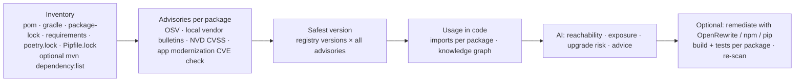

# AI Dependency Security Advisor

> Developers use third-party open-source packages from Maven Central, npm and PyPI. Vulnerabilities are continuously
> discovered and published in databases such as NVD, GitHub Security Advisories, OSV and vendor security bulletins.
> Developers struggle to identify vulnerable dependencies, understand the impact, and determine the safest version
> to upgrade to without introducing compatibility issues.

The advisor splits the problem into a **deterministic core** (facts that must never be hallucinated) and an **AI
layer** (judgement that needs reading code and changelogs), and ships in the kit.

## Abbreviations

NVD – National Vulnerability Database (NIST). GHSA – GitHub Security Advisory. OSV – Open Source Vulnerabilities
(osv.dev, aggregates GHSA, PyPA, npm, Maven, Go … advisories). CVE – Common Vulnerabilities and Exposures id.
CVSS – Common Vulnerability Scoring System. PyPI – Python Package Index. SBOM – Software Bill of Materials.

## Pipeline

### 1. Inventory (deterministic)
- Maven: declared dependencies, parent and `dependencyManagement` with property resolution; with `--resolve` the full
  resolved tree (`mvn dependency:list`) including transitive dependencies (direct ones are flagged).
- Gradle: declared `group:name:version` coordinates.
- npm: `package-lock.json` v1/v2/v3 including transitive packages (direct/dev flagged); without a lock file,
  `package.json` ranges are approximated by their lower bound (a warning is emitted).
- PyPI: pinned `requirements*.txt` lines, `poetry.lock`, `Pipfile.lock`; unpinned requirements are reported.

### 2. Advisories (deterministic)
- **OSV** `POST /v1/query {package}` returns *every* advisory for a package (all versions) – needed for step 3.
- **Vendor / internal bulletins**: any `*.json` file in OSV format in `--extra-advisories` (UI/API: `appmod.advisor.extra-advisories-dir`).
- **NVD**: optional CVSS base score lookup for CVE aliases (`NVD_API_KEY` for rate limits).
- **GitHub Copilot app modernization**: for Java, `appmod-validate-cves-for-java` is called (through the agent) as a second source; disagreements are reported.
- Severity = advisory database rating (GHSA `CRITICAL/HIGH/MODERATE/LOW`), else computed from the CVSS v3 vector by
  the built-in calculator (matches NVD scores, e.g. 10.0 for CVE-2021-44228).
- OSV range semantics implemented: `introduced` / `fixed` / `last_affected`, explicit `versions`, withdrawn advisories.

### 3. Safest version (deterministic)
1. Fetch real published versions from the registry (Maven `maven-metadata.xml`, npm registry, PyPI JSON); drop
   pre-releases, **yanked** PyPI releases and deprecated npm versions.
2. Keep versions newer than the current one; evaluate **each candidate against all advisories** of the package (not
   only the ones affecting the current version – a "fixed" version can be vulnerable to a later advisory).
3. **Recommended** = the lowest safe candidate in the **current major line** (smallest change → lowest compatibility
   risk). If none exists, the lowest safe version overall, with a "major upgrade required" note.
4. **Latest safe** is reported too. Upgrade type patch/minor/major → compatibility risk LOW/MEDIUM/HIGH.
5. Transitive dependencies get the right remediation hint (Maven `dependencyManagement`, npm `overrides`, pins).

Example (real registry data, fixture advisories):

| Package | Current | Advisories | Recommended | Why not the obvious one |
|---|---|---|---|---|
| log4j-core | 2.14.1 | CVE-2021-44228, -45046, -45105, -44832 | **2.17.1** (minor) | 2.15.0 fixes Log4Shell but is still affected by three later CVEs |
| lodash | 4.17.15 | CVE-2020-8203, CVE-2021-23337 | **4.17.21** (patch) | 4.17.19 still affected by CVE-2021-23337 |
| requests | 2.25.0 | CVE-2023-32681, CVE-2024-35195 | **2.32.2** (minor) | 2.32.0 / 2.32.1 were yanked from PyPI |

### 4. Usage (deterministic)
Source files importing each package (Java/Kotlin imports matched by groupId prefixes, JS/TS `import`/`require`,
Python `import`/`from` with common distribution→module name mapping) and the knowledge graph's
`uses-package` query. A direct dependency imported nowhere is flagged as a removal candidate.

### 5. AI layer (agent `dependency-security-advisor`)
Reads the report and the advisories, inspects the code paths that use the package, classifies **reachable /
possibly reachable / not reachable**, considers **exposure** (internet-facing endpoints from the knowledge graph,
test scope), reads **release notes** between current and recommended version for breaking changes, and writes
`.appmod/advisory/advice.md`. In remediation jobs it applies upgrades deterministically and verifies each one.

## Using it

| Where | How |
|---|---|
| Kit | ask `appmod-harness` (it delegates to the internal advisor and, for Java fixes, to app modernization); prompts `/dependency-advisor`, `/fix-cves`; by hand or in CI: `java .github/appmod/tools/DependencyAdvisor.java scan . [--resolve]` |
| Engine | a Black Duck Hub report published on `bdh.issuefixesAgent` goes to `appmod-harness`, which uses the advisor and then the plugin (see `engine/docs/integrations.md`) |
| CI | `--fail-on HIGH` exits 1; publish `advisory.md` as a build artifact |

## Configuration

The tool takes options on its command line: `--osv-url` (or an internal OSV mirror), `--maven-repo`, `--npm-registry`, `--pypi-url` (registry mirrors are fine), `--nvd`
(with `NVD_API_KEY` in the environment) and `--extra-advisories DIR` (vendor bulletins as OSV JSON). `java DependencyAdvisor.java` without arguments prints them all.

## Limitations and next steps

- Version ordering is a pragmatic union of Maven/semver/PEP 440 rules; exotic schemes may need ecosystem-specific comparators.
- Gradle inventory is declared-only (resolved Gradle trees would need running Gradle with a dependency report).
- Reachability is judged by the agent from code + advisory text, not by call-graph analysis; mark findings
  "possibly reachable" when unsure.
- Next: SBOM (CycloneDX) export, a scheduled re-scan of all projects with alerts, a PR per package.
