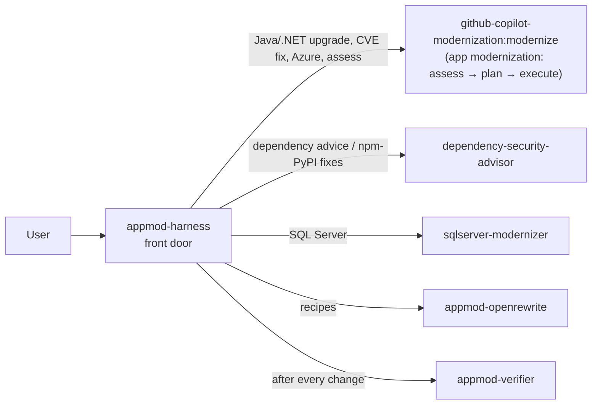

# Installing the kit and using appmod.cmd

A folder of agents, skills, custom instructions, prompt files, a planning rulebook and two single-file Java tools.
Anyone integrates it with GitHub Copilot **by placing it in the right folder** – no server, no build.
The kit always routes the actual migration to **GitHub Copilot app modernization**.

## Contents

```
kit/
├── .github/
│   ├── copilot-instructions.md                 repository-wide pointer to the kit (merged on install)
│   ├── instructions/
│   │   ├── appmod-harness.instructions.md      ground rules for every modernization task (applyTo **)
│   │   └── sqlserver.instructions.md           T-SQL editing rules (applyTo **/*.sql)
│   ├── modernize/rulebook/                     app-modernization planner policies (override assessment)
│   │   ├── 00-enterprise-standards.md          targets (Java 21, Spring Boot 3.5), plan ordering, out-of-scope
│   │   ├── 10-security-guardrails.md           CVE policy, no suppressions without review, no TLS/CSRF bypass
│   │   └── 20-openrewrite-first.md             treat OpenRewrite output as done; mechanical changes via recipes
│   ├── agents/
│   │   ├── appmod-harness.agent.md             ★ THE entry point (user-invocable); delegates to app modernization
│   │   │                                         and to the internal agents below (user-invocable: false)
│   │   ├── appmod-verifier.agent.md            final gate: build+test, guardrail check, writes the report
│   │   ├── appmod-openrewrite.agent.md         applies recipes, fixes only recipe-induced compile errors
│   │   ├── dependency-security-advisor.agent.md  AI Dependency Security Advisor
│   │   └── sqlserver-modernizer.agent.md       T-SQL / SQL project modernization (assess→plan→execute→report)
│   ├── skills/
│   │   ├── openrewrite-recipes/                how to run recipes (Maven/Gradle/declarative) + catalog
│   │   ├── code-knowledge-graph/               build/query the knowledge graph (impact analysis)
│   │   ├── dependency-security-advisor/        scan → impact → advise → remediate
│   │   ├── tsql-migration/                     T-SQL feature matrix: compat level, Azure SQL, PostgreSQL
│   │   └── harness-reporting/                  .appmod/result.json + summary.md + needs-input contract
│   ├── prompts/                                VS Code prompt files (slash commands), all run on appmod-harness
│   │   ├── modernize-java.prompt.md  fix-cves.prompt.md  dependency-advisor.prompt.md
│   │   └── sqlserver-modernize.prompt.md  code-graph.prompt.md
│   └── appmod/tools/
│       ├── CodeGraph.java                      knowledge graph builder/query (single file, no dependencies)
│       ├── DependencyAdvisor.java              dependency advisory (single file, no dependencies)
│       └── rewrite-init.gradle                 OpenRewrite for Gradle without editing build files
├── .vscode/mcp.json                            app-modernization MCP server for VS Code
├── copilot-cli/mcp-config.json                 same for Copilot CLI (~/.copilot/mcp-config.json)
├── appmod.cmd                                 Windows setup: tools + plugin + kit (`appmod --help`)
└── install/KitInstaller.java                   copies the kit files (JDK 25; called by appmod.cmd)
```

## Prerequisites and install – `appmod init`

On Windows one command prepares the machine **and** the repository:

```
kit\appmod.cmd init C:\src\orders-service
```

(`appmod.cmd` at the repository root forwards to it, so `appmod init …` works from there too.)

Every step **checks first** and only installs or changes something that is missing or too old; running `init`
again on a ready machine installs nothing. No administrator rights are needed except where a Windows installer asks.

| # | Step | Check | Action only when needed |
|---|---|---|---|
| 1 | Windows prerequisites | `curl`, `tar` (Windows 10 1803+), WinGet present? | – (without WinGet direct downloads are used) |
| 2 | **Volta** (Node.js version manager) — *Copilot only, for the plugin* | `volta --version` | WinGet `Volta.Volta`, otherwise the Volta MSI from GitHub |
| 3 | **Node.js 22 + npm 10** — *Copilot only: the app-modernization plugin runs its hooks with `node` and its MCP server with `npx`* | Volta's default Node (another Node.js on PATH is reported and left alone) | `volta install node@22`, `volta install npm@10` – old Node versions stay available to projects that pin them |
| 4 | PowerShell 7, Git | `pwsh`, `git` | WinGet `Microsoft.PowerShell`, `Git.Git` |
| 5 | **Copilot CLI ≥ 1.0.55** — *Copilot only* | `copilot --version`, install source (npm / WinGet) | **WinGet** unless `--installer npm` (npm needs the Node of step 3); an older CLI is upgraded through the same source |
| 6 | Copilot sign-in | `COPILOT_GITHUB_TOKEN` / `GH_TOKEN` / `GITHUB_TOKEN` | offers `copilot login` |
| 7 | **App modernization plugin ≥ 1.24.0** | marketplace registered? plugin in `copilot plugin list --json`? version? enabled? | `marketplace add` only if missing, `plugin install` only if missing, `plugin update` only if older, `plugin enable` only if disabled |
| 8 | **JDK 25+** (for KitInstaller, the kit tools, the audit validators and the engine) | `JAVA_HOME`, `PATH`, `%USERPROFILE%\.jdks`, `%LOCALAPPDATA%\appmod\tools`, Program Files (Adoptium, Microsoft, Oracle, Corretto, Zulu) | portable Eclipse Temurin 25 into `%LOCALAPPDATA%\appmod\tools` |
| 9 | **Kit files** | KitInstaller compares every file | copies new files; identical files are skipped; changed files are kept unless `--force` |
| 9b | **Git checks and the source branch** (a git repository only) | git installed, `origin`, the host answers, a push is likely, the source branch exists | prints the results and the detected default branch; in a terminal you confirm or choose the branch, saved to `.appmod/publish.json`; without a terminal nothing is saved; never fails the install; `--upgrade` keeps the file (see [engine/docs/publishing.md](../../engine/docs/publishing.md)) |
| 10 | Optional Maven 3.9+ (`--with-webapps`), .NET SDK 8 (`--with-dotnet`, SQL Server pack) | `mvn -v`, `dotnet --list-sdks` | portable Maven zip / WinGet |

Portable tools (JDK, Maven) can be added to the user `PATH` (and `JAVA_HOME` set if empty) – the script asks, or use
`--persist-path` / `--no-persist`.

**Why npm or WinGet, not uv?** GitHub publishes Copilot CLI for npm, WinGet, Homebrew and direct download only;
there is no uv/pip package. Node.js is installed for the GitHub Copilot tool only, because the app-modernization plugin's hooks (`node ...mjs`) and its
MCP server (`npx`) need it (read from the installed plugin v1.24.0); the kit's own tools, the engine and the validators are Java and need no Node.
With `--tool claude` none of steps 2, 3, 5, 6 and 7 runs.

### All commands (`appmod --help`)

| Command | What it does |
|---|---|
| `appmod setup [--roots a,b] [--tool copilot\|claude] [--yes] [--check] [--nats-port n] [--engine-jar path]` | **Once per machine**, for the engine: finds JDK 25 (as `init` does), finds `nats-server` or downloads the pinned one (SHA-256 checked, only over HTTPS), builds the engine, **asks for the folders of your repositories and your agent**, saves them in `%LOCALAPPDATA%\appmod\machine.properties`. See [engine/docs/setup.md](../../engine/docs/setup.md) |
| `appmod start [--nats\|--engine]` | NATS (on `127.0.0.1` only; an answering one is reused) in the background and the engine in this terminal, from the saved configuration; `--nats` or `--engine` start just one |
| `appmod init <dir> [options]` | Everything above, for one repository (it warns when the repository is outside the folders given to `setup`) |
| `appmod doctor [<dir>]` | The same checks, **changes nothing**; exit code 1 if something is missing |
| `appmod plugin status` · `install` · `upgrade` | Only the app-modernization plugin |
| `appmod upgrade [plugin]` | Refresh the marketplace catalog, update the plugin, report "updated from vX to vY" or "already at latest" |
| `appmod upgrade copilot` · `node` · `all` | Copilot CLI (through its install source), Node/npm through Volta, or everything |
| `appmod upgrade kit <dir>` | Preview what a newer kit would change (a dry run), ask, then apply it with `--upgrade`: only files nobody edited are replaced (see [updating.md](updating.md)); `--force` also replaces edited files |
| `appmod kit <dir>` | Kit files only (finds/installs the JDK, runs KitInstaller) |
| `appmod version` | Script version and pinned versions |

Options: `--tool copilot|claude|both`, `--installer winget|npm`, `--yes` (unattended: WinGet, no sign-in prompt), `--with-mcp`, `--with-webapps`,
`--with-dotnet`, `--skip-login`, `--force`, `--persist-path`, `--no-persist`. Version pins can be overridden with
environment variables (`APPMOD_NODE_MAJOR`, `APPMOD_JAVA_MAJOR`, `APPMOD_PLUGIN_MIN`, …, see `--help`).

Example output of a second run:

```
== GitHub Copilot app modernization plugin (minimum 1.24.0)
   [OK]   Marketplace github-copilot-modernization already registered
   [OK]   Plugin github-copilot-modernization@github-copilot-modernization v1.24.0 already installed - nothing to do
== JDK 25+ (KitInstaller, the kit tools, the validators and the engine)
   [OK]   JDK 25.0.5 at C:\Users\dev\.jdks\temurin-25.0.5
```

**macOS / Linux / VS Code only.** Install the same pieces by hand – Copilot CLI (`npm i -g @github/copilot`), the
plugin (`copilot plugin marketplace add microsoft/github-copilot-modernization` then
`copilot plugin install github-copilot-modernization@github-copilot-modernization`), Node 22 for the plugin, JDK 25 – and run KitInstaller
directly as shown below. In VS Code, install the "GitHub Copilot app modernization" extension.

### KitInstaller (kit files only)

`appmod init` calls it for you; you can also run it directly. It only copies files – tools and the plugin are the
script's job.

**Repository install (recommended)** – everyone working on the repo gets the same behaviour, and changes are reviewed
like code:

```
cd kit
java install/KitInstaller.java --target C:\src\orders-service --with-mcp      # --dry-run to preview, --force to overwrite changed files
```

The installer copies `.github/{agents,skills,instructions,prompts,modernize/rulebook,appmod/tools}`, appends a marked
block to an existing `.github/copilot-instructions.md` instead of overwriting it, adds `.appmod/` to `.gitignore`,
and with `--with-mcp` copies `.vscode/mcp.json`.

**User install** – agents, skills and tools for all your repositories (Copilot CLI reads `~/.copilot/agents` and
`~/.copilot/skills`):

```
java install/KitInstaller.java --user
```

Instructions, prompts and the rulebook are repository concepts – install them with `--target`.

**Manual install** – copy the `.github` folder into the repository. That is all the installer does.

## Use in Copilot CLI – one entry point

Users only ever start **`appmod-harness`**. It routes internally; the specialists are hidden
(`user-invocable: false`, the same mechanism app modernization uses for its coordinators).

```
cd C:\src\orders-service
copilot --agent=appmod-harness
> upgrade this app to Java 21 and Spring Boot 3.5
> which of our dependencies are vulnerable and what should we upgrade to?
> assess db/ for migration to Azure SQL Database
> what breaks if OrderService changes?

# unattended
copilot --agent=appmod-harness -p "fix all HIGH and CRITICAL CVEs" --allow-all
```



### How the front door uses app modernization

App modernization's `modernize` is built to be the top-level agent: it owns all questions to the user and, when it
runs as a sub-agent, it returns its question and stops. `appmod-harness` handles that by design:

1. **Decide up front** – asks you for targets, scope and limits before delegating (headless: rulebook defaults).
2. **Prepare** – knowledge graph, OpenRewrite pre-pass via `appmod-openrewrite`, dependency advisory for CVE work.
3. **Delegate once in headless form** – a complete request to `github-copilot-modernization:modernize` with every
   decision included, pointing to the pre-pass results and the rulebook.
4. **Relay questions** – if app modernization still stops with choices, the front door shows you exactly those
   options and re-delegates with your answer, resuming from the saved plan (`.github/modernize/<plan>/plan.md`,
   "execute the existing plan") rather than starting over. Max three resumptions.
5. **Verify and report** – `appmod-verifier`, then `.appmod/result.json` / `summary.md`.

Batch (multi-repository) modernization is not routed through the front door.

Power users can still call `copilot --agent=github-copilot-modernization:modernize` directly – the rulebook and
instructions apply there too – but that skips the front door's preparation and verification, so it is not the
documented path.

## Use in VS Code

1. Open the repository, switch Copilot Chat to **Agent** mode.
2. Run a prompt file: type `/modernize-java`, `/fix-cves`, `/dependency-advisor`, `/sqlserver-modernize` or
   `/code-graph`; VS Code asks for the `${input:…}` values. Every prompt file runs on `appmod-harness`
   (`agent: appmod-harness` in its front matter).
3. Or pick **appmod-harness** in the agent picker and chat normally. (VS Code may still list the internal agents if
   your version ignores `user-invocable`; their descriptions say "Internal – do not start directly".)

## The tools (pure Java, run from the repository root)

```
# Knowledge graph
java .github/appmod/tools/CodeGraph.java build . .appmod/knowledge-graph
java .github/appmod/tools/CodeGraph.java query .appmod/knowledge-graph/knowledge-graph.json impact OrderService

# Dependency advisory
java .github/appmod/tools/DependencyAdvisor.java scan . --out .appmod/advisory --resolve
java .github/appmod/tools/DependencyAdvisor.java check Maven org.apache.logging.log4j:log4j-core 2.14.1
```

Agents call these themselves when the skills tell them to; you can also run them in CI
(`--fail-on HIGH` makes the advisor exit with code 1).

## How app modernization is used underneath

| Kit piece | App-modernization feature it relies on |
|---|---|
| `.github/modernize/rulebook/*.md` | Read by the `modernize` planner; rulebook policies override assessment results |
| `appmod-harness` agent (and every prompt file) | Delegates Java/.NET work to the `modernize` orchestrator (assess → plan → execute) as a sub-agent, relaying its questions |
| `dependency-security-advisor` skill | Cross-checks Java findings with `appmod-validate-cves-for-java` |
| `code-knowledge-graph` skill | Produces app-modernization-compatible `knowledge-graph.json` without Python |
| `.vscode/mcp.json`, `copilot-cli/mcp-config.json` | Make the app-modernization MCP tools directly callable |

## Customising

- Org-wide changes: edit the kit and roll it out (`appmod upgrade kit <dir>` brings a repository's kit files up to date and keeps any file you edited).
- Repository-specific: add `*.instructions.md` to `.github/instructions/` and policies to `.github/modernize/rulebook/`
  in that repository. See [06 Custom instructions](06-custom-instructions.md).

## Limitations

- No central queue or audit trail of its own: that is what the engine adds (`engine/`).
- In `-p` (non-interactive) CLI runs nobody can answer questions; agents follow the headless rules and the
  `needs-input` contract (see `harness-reporting` skill).
- Delegating to `modernize` as a sub-agent relies on Copilot CLI's nested sub-agent support; app modernization's
  interactive phase gates (e.g. "Execute / Review") are replaced by the front door's up-front decisions and the
  relay protocol above. Verify with your Copilot CLI version (see docs/12).
